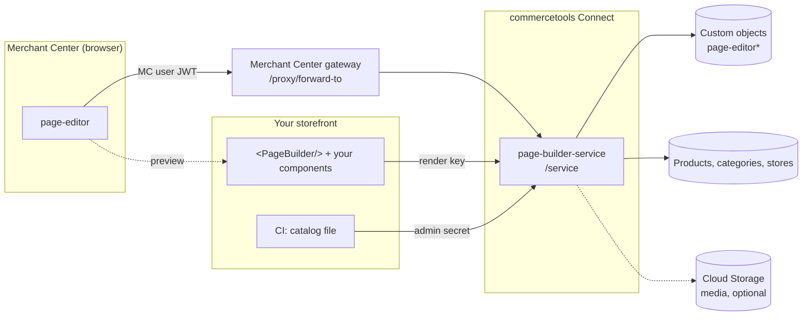

> **commercetools Labs, unsupported.** Freely available reference code under the MIT license, shared as-is
> and not covered by commercetools support. See [SUPPORT.md](SUPPORT.md) and [LICENSE](LICENSE).

# Page builder

Let content and merchandising teams build storefront pages themselves, inside the Merchant Center, from
components your developers define.

Storefront pages are usually built by developers and changed by developers. Every new landing page, seasonal
campaign or reordered homepage becomes a ticket and a release, even though the people who know what the page
should say are in content and merchandising.

The page builder lets those teams assemble and publish pages on their own. Authors drag approved building
blocks onto a canvas, bind them to live commercetools data such as product lists and categories, preview the
draft in the real storefront, and publish. Developers keep ownership of the design system and of what is
allowed on a page.

It is made for teams that run a headless storefront on commercetools and want content-led pages (home,
landing, category and product templates) without giving authors a way to break the site. It installs once per
commercetools project through commercetools Connect.

| I want to | Read |
|---|---|
| Use the editor | [docs/using-the-editor.md](docs/using-the-editor.md) |
| Understand how it works | [docs/architecture.md](docs/architecture.md) |
| Deploy it with Connect | [docs/connect-deployment.md](docs/connect-deployment.md) |
| Connect my storefront | [docs/host-integration.md](docs/host-integration.md), step by step in [skills/integrate-page-builder](skills/integrate-page-builder/SKILL.md) |
| Define components, data sources and sections | [docs/catalogs.md](docs/catalogs.md) |
| See how pages are stored | [docs/data-model.md](docs/data-model.md) |
| Run, test and change the code | [docs/development.md](docs/development.md), [CONTRIBUTING.md](CONTRIBUTING.md) |
| Look up a service configuration key, scope or failure mode | [page-builder-service/README.md](page-builder-service/README.md) |
| Use the storefront package | [packages/page-builder/README.md](packages/page-builder/README.md) |
| Read the wire contracts and the HTTP API | [docs/sdd/](docs/sdd/README.md), [openapi.yaml](page-builder-service/openapi.yaml) |

## Overview

The project has three parts. Two are Connect applications described by one [`connect.yaml`](connect.yaml);
the third is an npm package your storefront installs.

| Part | Folder | Runs as | What it is |
|---|---|---|---|
| `page-editor` | [page-editor/](page-editor) | Connect `merchant-center-custom-application` | The editor: a page tree, a drag-and-drop canvas, drafts, version history, live preview and publishing |
| `page-builder-service` | [page-builder-service/](page-builder-service/README.md) | Connect `service`, endpoint `/service` | Turns a published page into a ready-to-draw render tree, ingests the catalog from CI, and is the editor's only way to the stored pages |
| `@commercetools-labs/page-builder` | [packages/page-builder/](packages/page-builder/README.md) | npm package in your storefront | One `<PageBuilder>` mount that draws the page with your own React components |

What you get:

- **Pages authors can own.** A page tree that mixes static pages, category pages, product detail templates
  with per-category overrides, and dynamic pages, each with a draft, a version history and a publish step.
- **A vocabulary developers control.** Components, their editable fields, data sources and page sections are
  declared in a catalog file in your storefront repo and pushed by CI. Authors can only use what it allows.
- **Live commerce data.** Components bind to data sources such as product lists and categories; the service
  resolves them into clean, localized shapes, so your components get data, not queries.
- **Real preview and in-place editing.** The editor shows the draft in your actual storefront and lets authors
  click an element on the page to edit it.
- **A storefront with no commercetools credentials** and no data-fetching code for these pages.
- **Optional media uploads** to a Google Cloud Storage bucket for image and video fields.

## What it is not

- It is not supported by commercetools (see the banner above).
- It does not render your storefront. Your components draw the page; the page builder decides which components,
  in what order, with what content and data.
- It does not replace a CMS for long-form editorial content, and it does not manage product data.
- It has no database of its own: everything is stored as custom objects in the commercetools project it is
  installed in, and nothing is deleted when you undeploy it.
- It registers no Subscription, API Extension or scheduled job, so it is never in the path of carts, orders or
  checkout.
- The storefront package targets React and Next.js (App Router). Other clients can call the HTTP API directly.

## Architecture at a glance



Developers define the vocabulary, authors assemble pages from it, and the service is the only thing that
reads and writes the stored pages. The storefront asks the service for a page and draws it; if the service is
slow or down, the storefront renders its own fallback. More in [docs/architecture.md](docs/architecture.md).

## Repository layout

| Folder | What it is |
|---|---|
| `page-editor/` | The Merchant Center custom application (yarn) |
| `page-builder-service/` | The Connect service (npm) |
| `packages/page-builder/` | The storefront package (npm) |
| `docs/` | The guides linked above; `docs/sdd/` holds the wire contracts shared by all three parts |
| `skills/integrate-page-builder/` | A step-by-step guide for integrating a client application, usable by people and coding agents |
| `connect.yaml` | The Connect contract for the editor and the service |

There is no root manifest: each part installs and builds on its own. The full layout is in
[docs/development.md](docs/development.md#repository-layout).

## Prerequisites

- A commercetools project with Product Search activated, and a Merchant Center account that may register
  custom applications.
- Access to commercetools Connect for that project.
- A storefront you can change (React/Next.js for the package, or any client that calls the HTTP API).
- Node.js 22 and Yarn 1 for local development.
- Optional, for media uploads: a Google Cloud Storage bucket and a service-account key.

## Quick start (local)

The service runs against an in-memory commercetools, so you can try it without credentials:

```bash
cd page-builder-service
npm install
npm run dev:fake       # http://127.0.0.1:8080/service
```

The editor runs in the Merchant Center's local development shell:

```bash
cd page-editor
cp .env.example .env     # then fill in your application id and project key
yarn install
yarn start               # http://localhost:3001
```

How to point the local editor at a local service, and every command: [docs/development.md](docs/development.md).

## Deployment summary

The editor needs the service's URL, which exists only after the service is deployed, so the deployment runs
twice.

1. Register the custom application in the Merchant Center with a placeholder URL.
2. Deploy the connector with the service configuration and a placeholder `PAGE_BUILDER_SERVICE_URL`.
3. Redeploy with `PAGE_BUILDER_SERVICE_URL` set to the service URL plus `/service`.
4. Put the editor's deployed URL into the Merchant Center registration.
5. Install the storefront package, mount it, and add the catalog push to your CI.

Every step, and how to check it worked: [docs/connect-deployment.md](docs/connect-deployment.md).

## Configuration

The keys in [`connect.yaml`](connect.yaml). Connect injects the commercetools API client (`CTP_*`) into the
service; it is never configured by hand.

**`page-builder-service`**

| Key | Kind | Required | Default | What it does |
|---|---|---|---|---|
| `PB_RENDER_ORIGINS` | standard | yes | | Storefront server origins allowed to call the render API |
| `PB_EDITOR_ORIGINS` | standard | yes | `https://mc.europe-west1.gcp.commercetools.com` | Merchant Center origins allowed to drive the visual-editing bridge |
| `PB_MC_ISSUER` | standard | no | | Merchant Center API gateway the editor's JWTs come from (`gcp-eu`, `gcp-us`, `gcp-au`, `aws-eu`, `aws-us` or a URL); unset turns the editor's service access off |
| `PB_MEDIA_BUCKET` | standard | no | | Cloud Storage bucket for uploaded media; set together with `PB_MEDIA_SERVICE_ACCOUNT_KEY_B64` |
| `PB_MEDIA_PATH_PREFIX` | standard | no | `page-builder/media` | Object key prefix inside the bucket |
| `PB_MEDIA_MAX_BYTES` | standard | no | `10485760` | Largest accepted upload in bytes |
| `PB_MEDIA_ALLOWED_TYPES` | standard | no | | Allowed upload content types; empty allows all supported types |
| `PB_CACHE_TTL_SECONDS` | standard | no | `15` | Seconds to cache commercetools reads; drafts are never cached |
| `PB_FACET_ATTRIBUTES` | standard | no | | Product attributes offered as facets, in order; empty derives them from the product types |
| `PB_FACET_LIMIT` | standard | no | `8` | Maximum number of derived facets |
| `LOG_LEVEL` | standard | no | `info` | `debug`, `info`, `warn` or `error` |
| `PB_RENDER_KEY` | secured | yes | | Key the storefront presents on render calls |
| `PB_ADMIN_SECRET` | secured | yes | | Bearer secret for catalog validate, push and publish from CI |
| `PB_PREVIEW_TOKEN` | secured | no | | Unlocks drafts and edit mode; unset disables preview |
| `PB_MEDIA_SERVICE_ACCOUNT_KEY_B64` | secured | no | | Service-account key for `PB_MEDIA_BUCKET`, base64 on one line |

**`page-editor`**

| Key | Kind | Required | Default | What it does |
|---|---|---|---|---|
| `CUSTOM_APPLICATION_ID` | standard | yes | | The id the Merchant Center returns when you register the application |
| `ENTRY_POINT_URI_PATH` | standard | yes | `page-editor` | The application's entry point path |
| `CLOUD_IDENTIFIER` | standard | yes | `gcp-eu` | `gcp-us`, `gcp-eu`, `aws-us` or `aws-eu` |
| `PAGE_BUILDER_SERVICE_URL` | standard | no | | The service URL including `/service`; empty keeps the editor on the Merchant Center GraphQL gateway and turns uploads off |
| `PAGE_BUILDER_SERVICE_HOOKS` | standard | no | | `all`, or a comma list of hook families that go through the service; empty means none |

Notes on each key: [page-builder-service/README.md](page-builder-service/README.md#configuration) and
[docs/host-integration.md](docs/host-integration.md#merchant-center-app-and-the-service).

## Required scopes

**API client of the service** (`inheritAs.apiClient.scopes` in `connect.yaml`)

| Scope | Why |
|---|---|
| `manage_key_value_documents` | Reads and writes the page, catalog and settings custom objects |
| `view_products` | Product Search, product projections and product types for data sources |
| `view_categories` | The category tree |
| `view_stores` | Resolving a store key to its id |

The service has no `manage_project` and no write access to anything but custom objects.

**OAuth scopes of the editor** (`oAuthScopes` in `page-editor/custom-application-config.mjs`): `view_products`
and `manage_products`, which the Merchant Center maps to the application's View and Manage permissions. With
the service handling the custom objects, authors need no custom-object permission of their own.

## When something is down

The service is never in the path of a commercetools write. In short: the storefront degrades to its own
fallback when the service fails or takes longer than 2 seconds; catalog pushes, editor saves, uploads and
every credential check fail closed. The full table is in the
[service README](page-builder-service/README.md#fail-open-or-fail-closed).

## Operations

- **Health:** `GET /service/status` (alias `/healthz`).
- **Logs:** structured JSON; every line of a request carries its `X-Request-ID`, and editor writes are logged
  with `audit: true` and the acting user. Read them with
  `commercetools connect deployment logs --key <deployment> --application page-builder-service`.
- **Replay:** there are no events or queues. The one retryable write is the catalog push, which is idempotent.
- **Undeploy:** nothing is registered in the project, and pages stay in place as custom objects.

## Testing

- Editor: `cd page-editor && yarn test && yarn test:service` (Jest; the second run routes every data hook
  through the service).
- Service: `cd page-builder-service && npm test` (Vitest, in-memory commercetools, no credentials).
- Storefront package: `cd packages/page-builder && npm test`.
- Coverage, the shared test harness and its gotchas: [docs/development.md](docs/development.md) and
  [AGENTS.md](AGENTS.md#testing).

## Contributing

See [CONTRIBUTING.md](CONTRIBUTING.md). Contributions carry no support commitment.

## Support

This repository is unsupported. See [SUPPORT.md](SUPPORT.md).

## License

MIT, see [LICENSE](LICENSE).
