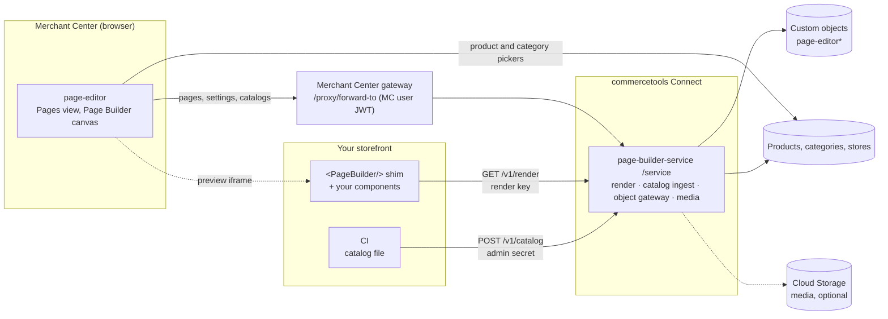

# Architecture

The page builder has three parts with one rule between them: **only the service touches commercetools on the
page builder's behalf.** The editor reaches the stored pages through the service, and the storefront asks the
service for a ready-to-draw page. Neither holds page-builder credentials.

## The parts

| Part | Folder | What it does |
|---|---|---|
| **Editor** | [`page-editor/`](../page-editor) | A Merchant Center custom application. Authors browse the page tree, compose pages on a canvas from the developer-defined components, bind data sources, save drafts, preview and publish. |
| **Service** | [`page-builder-service/`](../page-builder-service/README.md) | A Connect service, one per project. Matches a storefront path to a published page, resolves its data sources into [canonical shapes](sdd/canonical-shapes.md), and returns localized sections. Also ingests the catalog from CI and is the editor's gateway to the custom objects. |
| **Shim** | [`packages/page-builder/`](../packages/page-builder/README.md) | `@commercetools-labs/page-builder`, a React/Next.js package. One `<PageBuilder>` mount and a component map draw whatever the service returns. |

## Who owns what

- **Developers own the vocabulary.** A catalog file in the storefront repo declares the component types and
  their editable fields, the data sources (each naming a service resolver), the page sections and theme
  tokens. CI validates it and pushes it to the service. See [catalogs.md](catalogs.md).
- **Authors own the pages.** They assemble pages from that vocabulary in the editor. Every save appends a draft
  version; publishing makes it what the storefront renders. See [using-the-editor.md](using-the-editor.md).
- **The service owns the data.** Pages, catalog, settings and saved data sources are commercetools custom
  objects in the `page-editor*` containers. See [data-model.md](data-model.md).

## How a page reaches a shopper

1. The storefront's catch-all route mounts `<PageBuilder>` with the request path and the shopper's market
   (locale, currency, country, store).
2. The shim calls `GET /v1/render` with the render key. The service matches the path against the route
   templates in the project settings, picks the most specific published page, resolves its data sources and
   returns the render tree. Reads are cached for 15 seconds.
3. The shim draws each section with your components. If the service fails or exceeds the 2 second budget, the
   shim renders your fallback, so a down service degrades the page, not the site.

## How preview works

The editor shows the real storefront in an iframe. It adds a preview token (and an edit flag for in-place
editing) to the storefront URL; the storefront forwards the query string to the service, which then returns
the draft instead of the published page and bypasses the cache. The editor and the storefront talk over a
postMessage bridge so a click on the page selects the element in the editor. The contract is in
[sdd/preview-contract.md](sdd/preview-contract.md).

## Security boundaries

| Caller | Proves itself with | Can reach |
|---|---|---|
| Storefront shim | `X-PB-Render-Key` and an allowlisted origin | Published pages; drafts only with a valid preview token |
| CI | `Authorization: Bearer <PB_ADMIN_SECRET>` | Catalog validate, push and publish |
| Editor | The Merchant Center user's JWT, forwarded and signed by the gateway | The page-builder containers only; the host catalog is read-only |

Every check fails closed. Details per surface, and what happens when a dependency is down, are in the
[service README](../page-builder-service/README.md#fail-open-or-fail-closed).

## Further reading

- Wire contracts shared by all three parts: [sdd/](sdd/README.md)
- HTTP API: [openapi.yaml](../page-builder-service/openapi.yaml)
- Step-by-step integration of a client application: [skills/integrate-page-builder](../skills/integrate-page-builder/SKILL.md)
