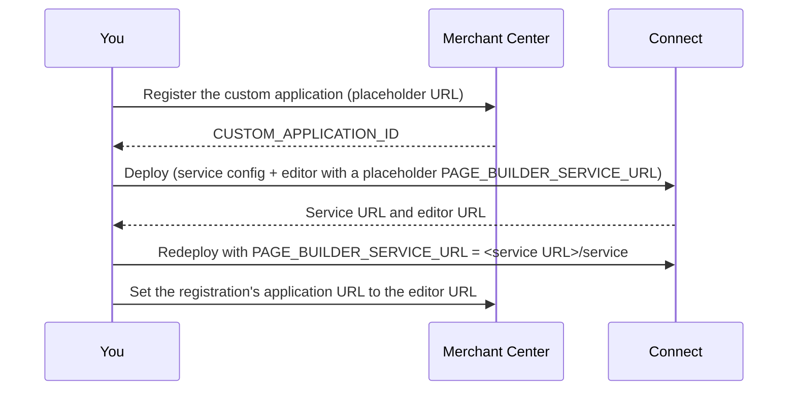

# Deploy to Connect

[`connect.yaml`](../connect.yaml) at the repo root declares both runtime pieces as commercetools Connect
applications, so one connector deploys the whole thing:

| Application | Type | What it is |
|---|---|---|
| `page-builder-service` | `service` (endpoint `/service`) | Render API, catalog ingest and the Merchant Center object gateway. Connect generates its API client at install time (scopes `manage_key_value_documents view_products view_categories view_stores`), so no commercetools credentials are configured by hand. |
| `page-editor` | `merchant-center-custom-application` | The editor, served inside the Merchant Center. |

## Why the order matters

The editor needs the service's public URL, and that URL exists only once the service has been deployed. So
the editor is deployed with a placeholder first and redeployed once the URL is known:

## Steps

1. **Decide the deployment type.** A sandbox deployment is fine to try it out, but it scales to zero and
   cold starts in about 15 seconds, longer than the storefront shim's 2 second budget. Use a
   production-type deployment for anything shoppers see. Product Search must be activated on the project.
2. **Register the custom application** in the Merchant Center with a placeholder URL, and note the
   `CUSTOM_APPLICATION_ID` it returns.
3. **Create a connector from this repository** (a git tag Connect can stage) and deploy it to your project.
   For the CLI mechanics (stage, publish, deploy, redeploy) see the Connect documentation.
4. **Configure `page-builder-service`.** Every key, its default and what it does is in the
   [service README](../page-builder-service/README.md#configuration). The ones you must set:
   - `PB_RENDER_KEY` (secured): the key your storefront presents on render calls.
   - `PB_ADMIN_SECRET` (secured): the bearer secret your CI uses to push the catalog.
   - `PB_RENDER_ORIGINS`: the storefront server origins allowed to call the render API.
   - `PB_EDITOR_ORIGINS`: the Merchant Center origin(s) allowed to drive the visual editor. It defaults to
     the `gcp-eu` Merchant Center.
   - `PB_MC_ISSUER`: your Merchant Center API gateway (`gcp-eu`, `gcp-us`, `gcp-au`, `aws-eu` or `aws-us`).
     Without it the editor cannot reach the service through the gateway.
   - Optional: `PB_PREVIEW_TOKEN` turns on draft preview, and `PB_MEDIA_BUCKET` with
     `PB_MEDIA_SERVICE_ACCOUNT_KEY_B64` turns on image and video uploads (see
     [Images and videos](host-integration.md#images-and-videos)).
5. **Configure `page-editor`:**
   - `CUSTOM_APPLICATION_ID`: the id from step 2.
   - `ENTRY_POINT_URI_PATH`: the entry point path (default `page-editor`, unique per cloud region).
   - `CLOUD_IDENTIFIER`: one of `gcp-us`, `gcp-eu`, `aws-us`, `aws-eu` (default `gcp-eu`).
   - `PAGE_BUILDER_SERVICE_URL`: a placeholder on the first deployment. Left empty, the editor keeps every
     hook on the Merchant Center GraphQL gateway and the media upload field is off.
   - `PAGE_BUILDER_SERVICE_HOOKS`: `all`, or a comma list of the hook families that go through the service
     (see [Merchant Center app and the service](host-integration.md#merchant-center-app-and-the-service)).
6. **Redeploy** with `PAGE_BUILDER_SERVICE_URL` set to the service URL Connect printed, **including
   `/service`**. Connect does not strip the endpoint from the URL.
7. **Update the Merchant Center registration** with the editor's deployed URL.
8. **Wire up the storefront and CI** by following [Wire it up](host-integration.md#wire-it-up): install the
   shim, mount it, and push the catalog after each deploy.

Configuration changes are a redeploy, never a delete and recreate.

## Done when

- `GET <service URL>/service/status` answers, and a render call without the render key is rejected.
- The app appears in the Merchant Center menu for a permitted user and the Pages screen loads.
- The service log shows authenticated gateway calls succeeding (not 401, not 403). A "wrong audience"
  rejection almost always means `PAGE_BUILDER_SERVICE_URL` is not the service's deployed URL.

## After deployment

The service has no `postDeploy` or `preUndeploy` script and registers nothing in your project (no
Extensions, Subscriptions, Types or Channels), so undeploying removes nothing from commercetools. Your pages
and catalog are custom objects and stay in place. Logs are structured JSON; read them with
`commercetools connect deployment logs --key <deployment> --application page-builder-service`.
